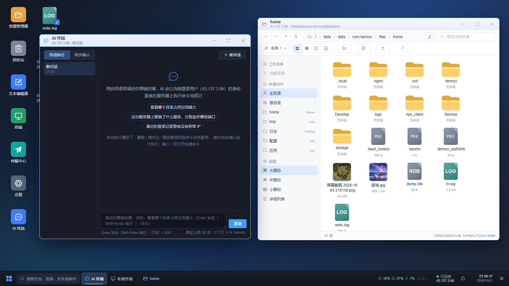
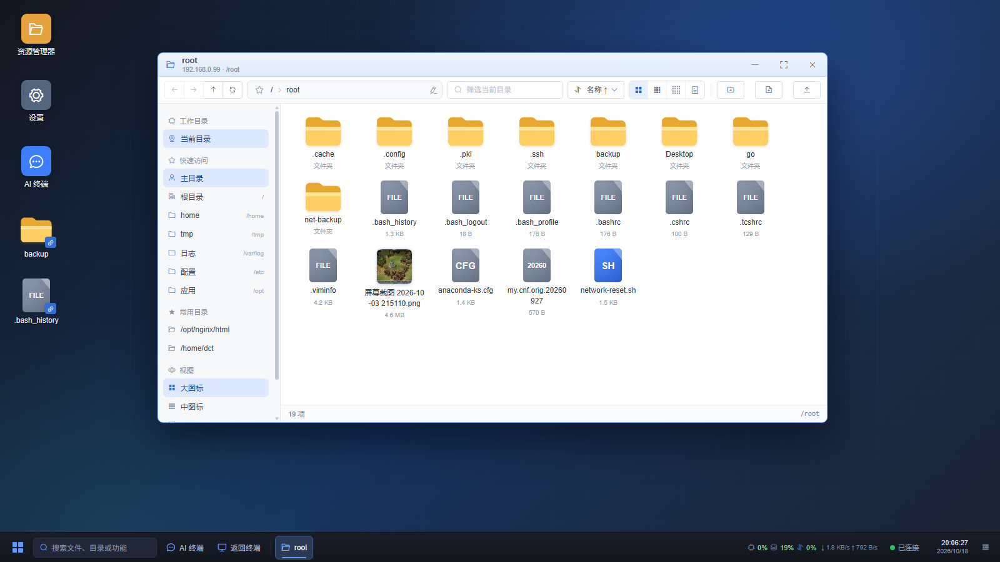
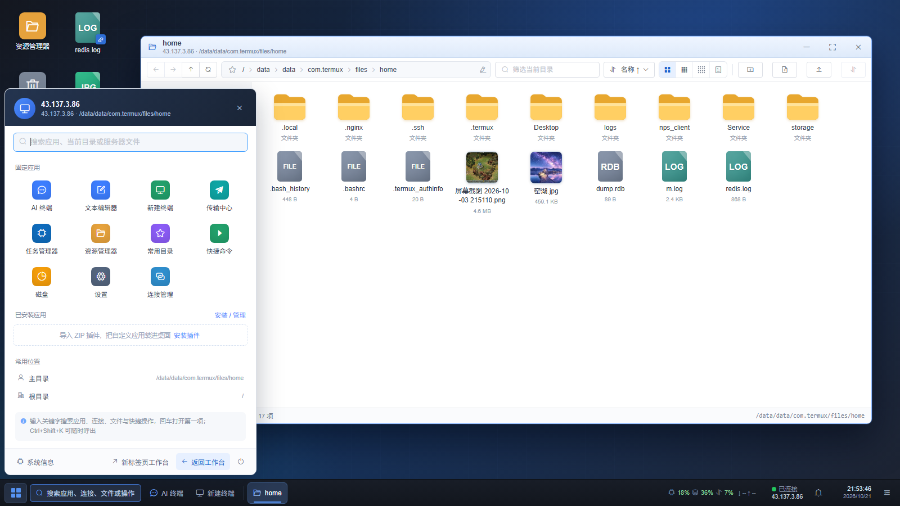
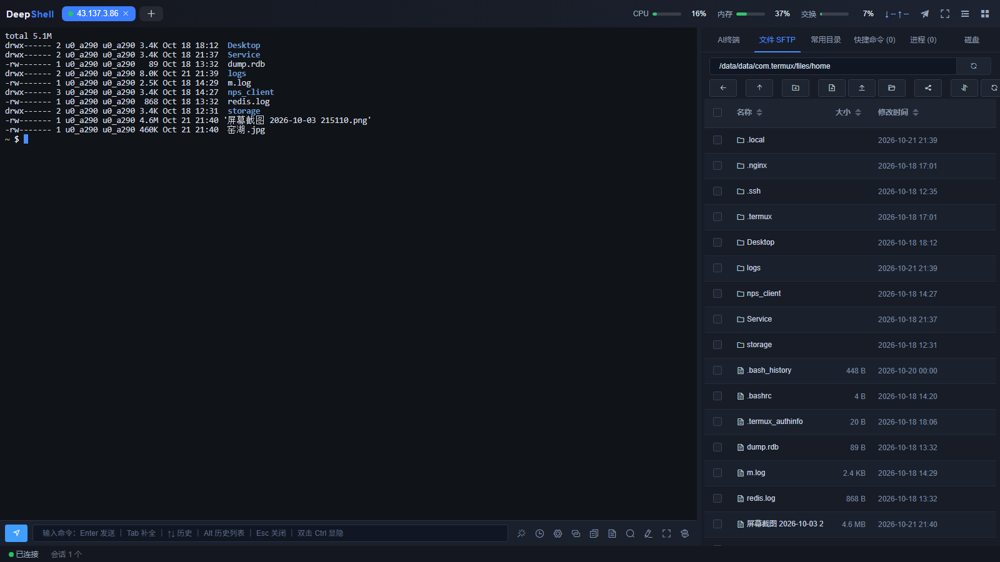

# DeepShell

现代化 Web 终端工具：SpringBoot + Thymeleaf + ElementUI + xterm.js。

**核心特色：AI 可视化桌面** —— 连接服务器后，在浏览器里直接进入一个 Windows 风格的远程桌面：可拖拽 / 缩放的资源管理器窗口、桌面图标、开始菜单、任务栏、时钟与实时监控一应俱全，还能把 AI 终端作为桌面窗口使用，边对话边操作服务器文件。

## 界面预览

### AI 可视化桌面



*桌面内同时打开资源管理器与 AI 终端：文件浏览、AI 自动执行命令、结果卡片都在同一个桌面里完成。*

| 桌面与资源管理器 | 开始菜单 |
|---|---|
|  |  |

### 工作台



*终端、AI 终端、SFTP、快捷命令、磁盘分析与实时监控集中在一个页面。*

## 核心特色：AI 可视化桌面

- **连接即桌面**：连接服务器后默认进入桌面，也可从 AI 终端工具栏一键打开；桌面背景、图标布局与窗口位置按连接分别记忆。
- **Windows 风格多窗口**：资源管理器支持拖动、八方向缩放、最小化 / 最大化 / 关闭；多窗口各有独立路径、前进 / 后退与选中状态，任务栏和「显示桌面」统一管理。
- **AI 与文件操作同屏**：任务栏「AI 终端」打开桌面内的对话窗口，与右侧 AI 面板共用对话、运行态和输入草稿；AI 执行命令时，资源管理器仍可继续浏览同一台服务器。
- **真实的远程 Desktop**：读取服务器当前用户的 `Desktop`（或 `桌面`）生成桌面图标，支持图片缩略图、快捷方式、拖拽排序和右键菜单；可自定义桌面背景，并提供时钟 / 月历、CPU / 内存 / 交换 / 网络监控与远端电源操作。

> 桌面中的文件能力与工作台 SFTP 完全一致：复制 / 剪切 / 粘贴、多选与框选、拖拽移动 / 上传、在线编辑、VSCode、下载（多选 ZIP / 逐个 / 本机直写）、压缩 / 解压、权限修改等。

## 功能

- **连接管理**：主机/端口/用户名、密码或密钥认证、备注；**多级文件夹树**（新建/重命名/删除文件夹，删除后内容自动上移不丢数据；编辑连接时以级联选择器归入任意层级）；**置顶与收藏**（每个连接可独立设置，收藏支持筛选）；密码基于本机密钥 AES-GCM 加密存储
- **多标签终端**：WebSocket 实时流式传输、窗口尺寸自适应（PTY Resize）、连接状态指示、断线提示；标签右键支持**复制 IP / 查看服务器系统信息**（主机名、发行版、内核、CPU、内存、磁盘占用、IP、运行时长、负载、系统时间，经独立 exec 通道采集）；**会话保持与自动重连**——WebSocket 断开或刷新页面后，服务端保留 SSH 会话 10 分钟并缓冲最近 256KB 输出，浏览器自动退避重连、重新附着并把输出回放，前台正在运行的命令不会因为 F5 被直接杀掉；点击标签关闭或「断开」才立即结束会话
- **SFTP 文件管理**：目录浏览、上传、下载、新建目录、**新建文本文件（输入文件名后直接打开在线编辑）**、重命名、删除（目录递归）、小文件在线编辑保存、**拖拽移动文件到文件夹**（拖动到表格边缘自动滚动、移动前弹出确认对话框明确"文件→目录"）；**目录跟随终端**——终端里 `cd` 后文件面板自动切到对应目录（工具栏链接图标可开关）；**系统文件可直接拖进浏览器窗口上传**到当前目录（拖入时显示目标目录，成功后弹提示）；**传输队列与分片续传**——上传按 4MB 分片写入数据目录临时文件，右下角队列显示进度，支持取消/失败重试，网络抖动后从服务端已收到的偏移继续（刷新页面后文件句柄失效，需要重新选择文件）；**文件夹上传**（选择文件夹后保留目录结构递归上传）与**文件夹打包下载**（自动生成 zip 后下载）；**名称左侧复选框支持多选**（表头可全选），选中后可批量**打包下载**（后端通过 SFTP 流式打包，浏览器只下载一次）或**逐个下载**文件（文件夹自动跳过）；**本机访问时还可「下载到本机」**——后端弹出原生目录选择框、自动创建子目录并通过 SFTP 直接写盘，传输队列显示进度，完成后可查看结果汇总 / 在文件管理器中打开目录（仅 127.0.0.1 / localhost，且运行环境需有图形界面）；**修改文件/目录权限**（SFTP 操作列或属性弹窗，支持 644/755/600/700 快捷值）；SFTP 工具栏另有返回上一目录（访问路径栈）、刷新与分析磁盘占用
- **快捷命令**：常用命令沉淀为片段，在工作台点击即执行（或仅填入待编辑）；面板顶部可选择**发送到当前会话 / 所有会话 / 勾选指定会话**（批量下发用）；每个命令可直接**编辑 / 删除**（工作台内点铅笔图标）
- **AI 生成命令**：终端底部命令栏点击魔法棒图标展开 AI 输入条，用自然语言描述需求（如"查看磁盘占用最大的前 10 个目录"），经 OpenAI 兼容接口自动翻译为 shell 命令并填入命令框待确认执行；在右上角菜单「AI 设置」中选择厂商（内置 DeepSeek / 通义千问 Qwen / 智谱 GLM / MiniMax / Kimi / OpenAI，也可自定义兼容地址），**模型列表由厂商接口实时获取**（一键刷新），从下拉直接选择而无需手填；API Key / 接口地址 / 模型 / AI 终端单轮步数上限（默认 30，1-100）均在此配置
- **AI 终端**（右侧面板第一个标签）：对话式 AI 运维——用自然语言描述需求（如"找出访问日志里请求最多的 IP"），AI 以当前会话的**登录用户身份**在服务器上自动执行命令、读取输出并逐步推进，直到任务完成；命令与输出以卡片展示在对话里（含退出码、可复制命令），经**独立 exec 通道**执行，不干扰正在操作的终端，AI 的 cd 目录会被自动跟踪；默认「**自动执行**」——删除 / 格式化 / 重启等**高风险命令会先暂停**等用户确认（面板内可切换「每步确认」）；**对话记录支持多对话并保存在 SQLite 数据库**（随数据目录一起迁移 / 备份）——面板左侧对话列表可新建 / 切换 / 删除，每个连接各自独立、每个对话有独立上下文、工作目录和输入草稿；**不同对话可同时生成与执行、互不阻塞**——正在输出的对话单独显示「停止」，其余对话仍可新建 / 切换 / 发送；**AI 回复经 SSE 流式返回、打字机式逐字显示**（生成中带闪烁光标，解析完成的命令仍以卡片展示）；**回复支持 Markdown**（列表 / 加粗 / 行内代码 / 代码块），模型返回 `reasoning_content` 时显示可折叠的**思考过程**；命令卡片显示**执行耗时**，长输出可**展开全部 / 复制输出**；**输入框支持 ↑↓ 历史、`/` 快捷命令、自动增高和中文输入法安全回车**，AI 执行中按 Enter 会把新要求**排队**并在本轮结束后自动发送；请求失败可一键重试；**点「停止」会真正中止本轮生成**——前端 abort 请求、服务端断开模型连接并终止正在执行的 AI 命令通道，不会在后台继续执行新命令（已执行完的命令不会回滚）；单条命令最长 120 秒、超长输出自动截断；**单轮默认 30 步，可在 AI 设置中调整（1-100）**，达到上限会暂停并给出「继续执行」按钮
- **AI 可视化桌面（虚拟桌面）**：连接建立后默认进入、也可从右侧 AI 终端工具栏「AI 可视化桌面」按钮进入的虚拟桌面（深蓝主题壁纸，支持自定义桌面背景）。资源管理器变成可拖动、八方向缩放、最小化 / 最大化 / 关闭的 Windows 风格窗口；同一连接可开多个窗口，各有独立路径、前进/后退（工具栏、鼠标侧键、Alt+← →）和选中状态，任务栏为每个窗口提供按钮，右下角「显示桌面」可一键最小化全部、再点还原；窗口位置按连接记忆，重开桌面时恢复。窗口内保留原有全部文件能力：大 / 中 / 小图标与详细列表、面包屑、快速访问、搜索排序、Ctrl / Shift 多选与框选、拖拽移动/上传、**复制 / 剪切 / 粘贴（Ctrl+C / Ctrl+X / Ctrl+V，复制支持文件夹递归，剪切粘贴走移动，同名目标提示已存在）**、在线编辑 / VSCode、下载（多选流式 ZIP / 逐个 / 本机直写）、重命名 / 删除 / 复制路径 / 属性 / 压缩（ZIP / 7Z / TAR / TAR.GZ / TAR.BZ2 / TAR.XZ）、图片缩略图与新标签预览等。底部任务栏含开始菜单（固定应用、常用位置、当前目录搜索、服务器文件递归搜索、电源 / 返回工作台）、搜索框、AI 终端入口、返回终端、资源管理器窗口按钮、CPU / 内存 / 交换 / 网络 / 连接托盘、精确到秒的时钟（左键弹出 Windows 风格月历，可翻月、回到今天、点选日期）与显示桌面。开始菜单「设置」打开控制面板式设置窗口，可调整默认文件视图、缩略图、隐藏文件、终端字体与背景、AI 桌面背景、桌面图标显隐、快捷键、时钟与空闲休眠，并查看 / 配置 AI、局域网和当前连接信息；开始菜单底部返回工作台旁有电源按钮，提供远端服务器关机 / 重启 / 断开（关机 / 重启需 root 或免密 sudo，操作前有危险确认并记入审计日志）。
- **桌面图标与本地 Desktop**：桌面按服务器当前用户 home 读取 `Desktop`（优先）或 `桌面`，都不存在时自动创建 `Desktop`（root 为 `/root/Desktop`），把其中的文件 / 文件夹 / 快捷方式映射为桌面图标。默认提供资源管理器（双击进入 `/`）、设置、AI 终端三个应用图标；所有图标使用统一顺序网格，可拖动调整顺序，新增文件追加到末尾，顺序与内置图标的隐藏状态按连接保存到 SQLite（`desktop_icon_layout`）。桌面空白右键支持粘贴、刷新、新建资源管理器窗口、个性化（打开设置并定位外观与桌面）和返回终端（新标签页打开工作台，保留当前桌面）；应用图标右键可打开 / 隐藏，隐藏后可在设置中恢复；文件和文件夹图标复用资源管理器右键菜单，并可「发送到桌面快捷方式」——在远程 Desktop 写入 JSON 格式 `.lnk`（`target` / `targetType`），不复制原文件，双击快捷方式解析并打开目标。桌面图片文件直接加载缩略图；快捷方式按目标类型显示文件夹图标、文件类型图标或图片缩略图，并在右下角叠加 link 角标，而不是显示通用的 LNK 文件图标。地址栏左侧星标可把当前目录加入 / 移出「常用目录」，资源管理器任务栏按钮右键可查看常用目录（点击在新窗口打开）、新建窗口和关闭。终端背景与 AI 桌面背景**分别配置**（各自上传或 URL、透明度、模糊度）。
- **AI 桌面窗口与返回终端**：任务栏「AI 终端」会在桌面内打开一个 AI 对话窗口，与右侧 AI 面板共用同一套对话列表、当前对话、输入和流式输出，支持新建 / 切换 / 删除对话、自动执行 / 每步确认、命令确认与停止；窗口本身和资源管理器一样可拖动、缩放、最小化、最大化、关闭，采用暗色对话控件。桌面任务栏的「返回终端」不再关闭桌面，而是在**新的浏览器标签页**打开同一连接的工作台，原标签页的桌面和所有窗口保持不变；开始菜单底部仍保留真正的「返回工作台」退出桌面。
- **服务器监控**：工作台顶栏实时显示远端 CPU / 内存 / 交换利用率（阈值变色进度条）与网络上下行速率；每 3 秒经独立 exec 通道采样 `/proc`，不占用交互终端；仅支持 Linux 服务器（Windows 目标会自动提示"监控不可用"）
- **进程管理**：类任务管理器面板——进程列表（名称/PID/用户/CPU/内存/状态/运行时长），瞬时 CPU 用 `/proc` 两次快照差分计算（与任务管理器同原理，而非 `ps` 的生命周期均值），支持排序、关键字过滤、3 秒自动刷新，以及结束（SIGTERM）/强杀（SIGKILL）进程；**单击进程行弹出详情**（PID/父进程/用户/状态/CPU/内存/运行时长/完整命令行，命令行可一键复制）
- **常用目录**：右侧面板「常用目录」标签——**按当前主机（连接）分别保存**，切换标签页自动切换，不同主机互不影响；把常用路径存成快捷入口（浏览到目标目录点「定位」一键添加，或直接输入路径），**点击条目即在终端执行 cd**（路径含特殊字符时自动安全转义），文件面板同步进入该目录；悬浮条目可移除。AI 可视化桌面地址栏左侧的星标可收藏 / 取消收藏当前目录，资源管理器任务栏按钮右键菜单也会列出同一份「常用目录」；这些入口与终端面板共用同一份按连接隔离的数据
- **磁盘分析**（WizTree 式）：右侧面板「磁盘」标签——对指定目录执行 `du` 列出每个子目录 / 文件的大小与占比（按大小降序、占比条展示），**点击文件夹逐层下钻**定位最占空间的目录，「↑」返回上级；SFTP 工具栏可一键「分析当前目录」直达；不跨文件系统挂载点统计
- **审计日志**：记录登录成功/失败、AI 终端执行的命令、文件上传/下载/删除/重命名/移动/改权限/压缩、连接新建/编辑/删除/导入/导出、Token 有效期调整；右上角菜单「审计日志」支持按操作和关键字筛选、分页查看并导出 CSV；默认保留最近 5 万条，避免数据库无限增长

- **登录认证（可选）**：`application.yml` 中开启后，访问工作台与 API 需先登录；账号密码可配置（默认 `admin` / `deepshell`），JWT 以 HttpOnly Cookie 保存，默认 6 小时过期；右上角菜单「登录与安全」可调整 Token 有效期，页面持续使用时会自动续期。默认关闭，本机使用无需登录。**同一 IP 密码连续错误 2 次后，第三次登录起必须输入图形验证码**（验证码 2 分钟有效、一次性使用，点击图片可刷新；登录成功后失败计数自动清零）
- **工作台菜单**（右上角汉堡按钮）：连接导入（支持一次框选多个文件，可导入 FinalShell 连接文件）/ 连接导出（弹窗勾选要导出的连接）、终端字体设置（即时生效并记忆）、快捷键设置（双击 Ctrl / Tab 补全 / Esc 关闭可开关）、终端背景设置（本地上传或 URL，透明度与模糊可调；终端背景自动透明透出；AI 桌面背景在桌面设置中单独配置，且按连接分别保存）、**AI 设置**（DeepSeek / 通义千问 / 智谱 GLM / MiniMax / Kimi / OpenAI 等厂商，兼容任意 OpenAI 接口，模型列表实时获取、下拉选择，用于命令翻译与 AI 终端，可调整单轮步数上限）、**局域网访问开关**（默认仅本机 127.0.0.1，开放并重启后局域网可访问，弹窗内提供访问地址复制与安全提示）

> 按需精简：不含多用户注册、配置云端同步、端口转发等非核心功能；单账号登录可在配置中按需开启。

## 技术栈

| 层 | 技术 |
|---|---|
| 后端 | Spring Boot 2.7.18（Java 8）、Spring WebSocket、Spring Data JPA、SQLite（xerial sqlite-jdbc，单文件零依赖）、JSch（mwiede 维护分支） |
| 前端 | Thymeleaf、Vue 2、ElementUI 2.15、axios、xterm.js 5 + fit 插件（全部本地 vendor 化，离线可用） |

## 快速开始

前置要求：JDK 8+、Maven。

```bash
# 构建（同时生成分发包 target/deepshell-1.0.0.zip）
mvn -DskipTests package

# 或直接运行 jar（开发调试）
java -jar target/deepshell.jar
```

### 分发包（推荐）

解压 `target/deepshell-1.0.0.zip` 后的目录结构：

```
deepshell-1.0.0/
├─ deepshell.jar      主程序
├─ application.yml    外置配置（可改端口 / 数据目录等，覆盖内置默认值）
├─ start.cmd          Windows 启动脚本（双击运行，关闭窗口即停止）
├─ start.sh           Linux 启动脚本（后台运行）
├─ stop.sh            Linux 停止脚本
└─ data/              运行数据（数据库 / 密钥 / 配置 / 日志 / 背景图）
```

- **Windows**：双击 `start.cmd`
- **Linux**：`./start.sh` 启动 / `./stop.sh` 停止（控制台输出见 `data/logs/console.log`）
- 启动完成后会自动打开默认浏览器；不需要时在外置 `application.yml` 设 `deepshell.open-browser: false`（或启动命令加 `-Ddeepshell.open-browser=false`）

开发模式（在 IntelliJ IDEA 中运行 `DeepShellApplication`）数据目录默认为 `~/.deepshell`；分发包数据全部位于程序目录 `data/` 下，拷贝整个目录即可迁移。

启动后访问 **http://127.0.0.1:18080**（也可以用 localhost；局域网模式下请用本机 127.0.0.1 或局域网 IP）

## 使用说明

1. 打开页面即是**工作台**（首页）：点标签栏「＋」或空状态「打开连接」弹出连接列表 → 可直接「新建连接」（密码认证直接填密码；密钥认证填**运行本工具的机器上**的私钥文件绝对路径，如 `C:\Users\you\.ssh\id_rsa`）；列表内可新建文件夹、编辑（含「所属文件夹」归入层级）、**删除连接**、拖拽连接入文件夹；**文件夹上右键「连接所有」**可批量打开该文件夹（含子文件夹）中的全部服务器
2. 点击「连接」后终端自动打开并登录；默认设置下连接建立后会自动进入 **AI 可视化桌面**（可在桌面「设置 → 外观与桌面」中切回工作台）。工作台标签栏「+」或空状态「打开连接」弹出**树形连接列表**（顶部「最近连接」区最多显示 5 个最近打开的连接，支持搜索、收藏筛选、置顶区；每个连接右侧 ⚙ 可快捷置顶 / 收藏 / 编辑连接；连接可直接**拖到文件夹上**归入文件夹）
3. 工作台右侧面板：
   - **AI 终端**：输入需求回车，AI 自动执行命令并回传结果，直到完成；高风险命令会先暂停等确认（详细见上方功能说明）
   - **文件 SFTP**：双击目录进入 / 双击文件在线编辑；顶部支持路径直达、上传、新建文件夹
   - **快捷命令**：点击 = 执行（自动追加回车）；点右侧 `+` = 仅填入终端，人工确认后回车
4. 顶部标签可开多个会话；中键或 × 关闭标签（会断开对应 SSH 连接）

## 数据与安全

| 数据 | 位置（数据目录下） |
|---|---|
| 连接 / 快捷命令 / 常用目录 / AI 对话数据 | `db/deepshell.db`（SQLite 单文件库） |
| 密码加密密钥 | `secret.key`（首次启动自动生成） |
| 登录签名密钥 | `auth.key`（首次启动自动生成；删除后所有登录 Token 失效） |
| 登录 Token 有效期 | `auth.properties`（在右上角「登录与安全」中修改后写入） |
| AI 接口配置 | `ai.properties`（厂商 / API 地址 / Key / 模型） |
| 终端背景图片 | `bg/` |
| AI 桌面背景图片 | `bg/desktop/<连接 ID>/`（旧版全局背景保留在 `bg/desktop/`，未单独设置的连接沿用） |
| 桌面图标布局 | `db/deepshell.db` 的 `desktop_icon_layout` 表（按连接保存顺序与隐藏状态） |
| VSCode 编辑副本 | `edit/` |
| 分片上传临时文件 | `uploads/`（完成或取消后删除，超过 24 小时自动清理） |
| 审计日志 | `db/deepshell.db` 的 `audit_log` 表（默认最多 5 万条） |
| 运行日志 | `logs/` |

> 数据目录：分发包默认为程序目录下的 `data/`（可在同级 `application.yml` 中修改）；开发模式为 `~/.deepshell`。拷贝该目录即可迁移全部数据（含密钥与数据库）。

- 密码/私钥口令经 AES-GCM 加密后落库，明文仅在提交与建立连接时短暂存在于内存
- 本工具设计为**本机使用**；请勿直接暴露到公网（SSH 连接代理无鉴权）

## 目录结构

```
src/main/java/com/itdct/deepshell/
├─ config/       WebSocket 配置
├─ common/       R 统一返回、全局异常、DataDir 数据目录解析
├─ entity/       SshConnection、QuickCommand、CommonDir、AiConversation、AuditLog、DesktopIconLayout
├─ repo/         Spring Data JPA
├─ dto/          SftpEntry、ConnectionForm、SftpReq
├─ service/      CryptoService（AES）、SshSessionManager（会话/泵线程）、SftpService、BackgroundImageService、DesktopIconLayoutService、CRUD 服务
├─ web/          页面路由 + REST API（connections / quick-commands / sftp / desktop-icons / terminal-bg / desktop-bg）
└─ ws/           SshWebSocketHandler（终端二进制流 + JSON 控制消息）

src/main/resources/
├─ templates/    workspace.html（工作台，即首页）
└─ static/
   ├─ css/app.css
   ├─ js/workspace.js、conn-form.js（可复用连接编辑弹窗组件）
   └─ vendor/    Vue / ElementUI / axios / xterm（本地化，无需外网）

dist/              分发包模板（application.yml / start.cmd / start.sh / stop.sh / data）
src/assembly/      maven-assembly 打包描述（dist.xml）
```

## 常用配置（application.yml）

内置默认配置在 `src/main/resources/application.yml`；分发包使用与 jar 同级的外置 `application.yml`，只需填写要覆盖的项：

```yaml
server.port: 18080             # 服务端口（默认 18080）
deepshell.data-dir: ./data     # 数据目录（默认 ~/.deepshell；分发包为 ./data）
deepshell.open-browser: true   # 启动后自动打开浏览器

# 登录认证（默认关闭；开启后必须登录才能访问工作台）
deepshell.auth.enabled: false
deepshell.auth.username: admin
deepshell.auth.password: deepshell
deepshell.auth.token-expire-hours: 6
deepshell.auth.captcha-fail-times: 2   # 同一 IP 连续失败多少次后要求验证码；0 表示关闭
```

> 登录账号密码在配置文件中为明文，请务必修改默认密码；开启登录后建议不要将服务直接暴露到公网。Token 有效期还可在右上角菜单「登录与安全」中在线调整（1 - 720 小时），设置保存在数据目录的 `auth.properties` 中。验证码按 TCP 连接的对端 IP 计数，不信任 `X-Forwarded-For`，避免伪造请求头绕过阈值。

## 开源协议

本项目采用 **AGPL-3.0-only** 协议开源，完整条款见 [LICENSE](LICENSE)。

- 个人使用、学习、审计、修改和自部署均免费。
- 分发修改版，或通过网络向用户提供服务时，必须按 AGPL-3.0 向用户提供完整对应的源代码。
- 如需闭源集成、商业分发、SaaS 不公开源码或 OEM 贴牌，请购买商业授权，详见 [COMMERCIAL.md](COMMERCIAL.md)。
- "DeepShell" 名称与 Logo 的商标使用权不随代码授权，详见 [TRADEMARK.md](TRADEMARK.md)。
- 贡献代码前请阅读 [CONTRIBUTING.md](CONTRIBUTING.md)，并同意 [CLA.md](CLA.md)。

Copyright (C) 2026 DecentAnt
