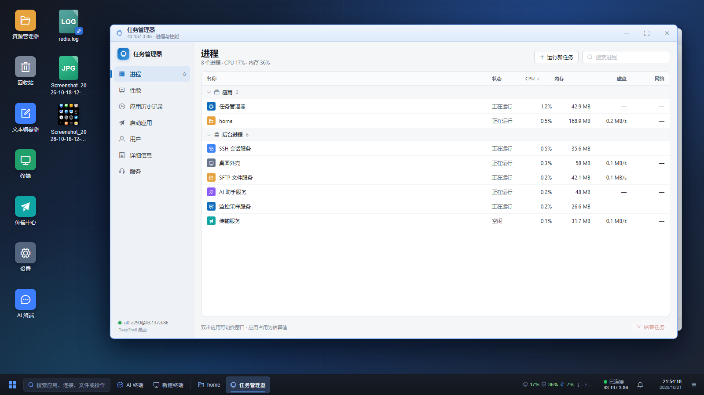
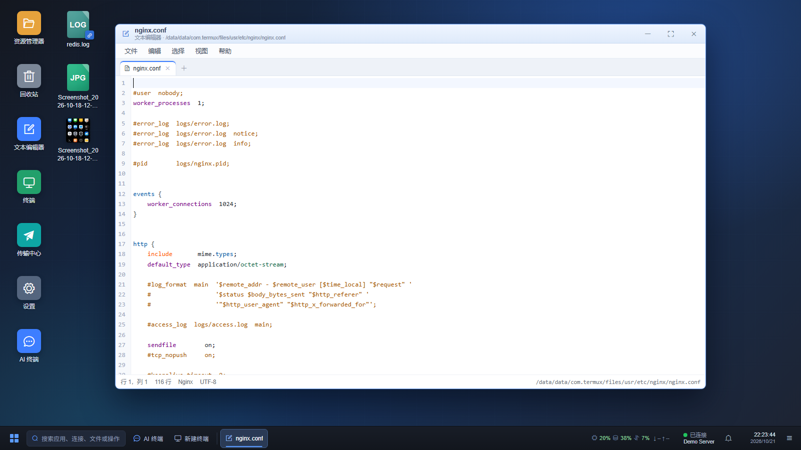
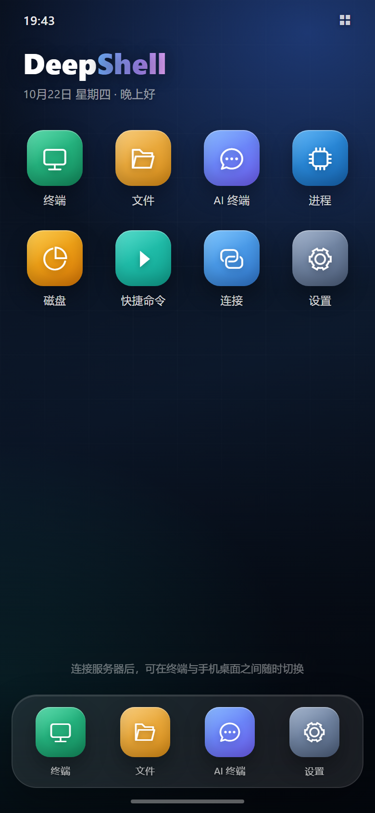
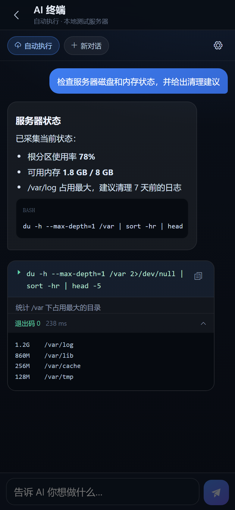

# DeepShell

现代化 Web 终端工具：SpringBoot + Thymeleaf + ElementUI + xterm.js。

**核心特色：AI 可视化桌面** —— 连接服务器后，在浏览器里直接进入一个 Windows 风格的远程桌面：可拖拽 / 缩放的资源管理器窗口、桌面图标、开始菜单、任务栏、时钟与实时监控一应俱全，还能把 AI 终端作为桌面窗口使用，边对话边操作服务器文件。

## 界面预览

### AI 可视化桌面


*桌面内同时打开 AI 终端与资源管理器：左边用自然语言让 AI 直接在服务器上执行命令并给出结论，右边继续浏览同一台服务器的文件，窗口可以随意拖动、缩放和贴边。*

| 桌面与资源管理器 | 开始菜单 |
|---|---|
|  |  |

| 任务管理器 | 文本编辑器 |
|---|---|
|  |  |

*桌面内置 Windows 风格任务管理器（进程 / 性能 / 应用历史 / 启动应用 / 用户 / 详细信息 / 服务七个页面）和多标签文本编辑器（顶部菜单栏、语法高亮、远程文件打开与另存为）。*

### 工作台


*终端、AI 终端、SFTP、快捷命令、磁盘分析与实时监控集中在一个页面。*

### 手机版

| 手机桌面 | AI 终端 |
|---|---|
|  |  |

*手机浏览器打开时自动进入独立的手机版：桌面采用手机图标网格，点图标进入全屏应用；底部 Dock 可快速回到终端、文件、AI 和设置。终端工作台与手机桌面双模式保留，桌面上的终端图标会显示当前会话数。*

## 核心特色：AI 可视化桌面

- **连接即桌面**：连接服务器后默认进入桌面，也可从 AI 终端工具栏一键打开；桌面背景、图标布局与窗口位置按连接分别记忆。
- **Windows 风格多窗口**：资源管理器支持拖动、八方向缩放、最小化 / 最大化 / 关闭；多窗口各有独立路径、前进 / 后退与选中状态，任务栏和「显示桌面」统一管理。
- **AI 与文件操作同屏**：任务栏「AI 终端」打开桌面内的对话窗口，与右侧 AI 面板共用对话、运行态和输入草稿；AI 执行命令时，资源管理器仍可继续浏览同一台服务器。
- **真实的远程 Desktop**：读取服务器当前用户的 `Desktop`（或 `桌面`）生成桌面图标，支持图片缩略图、快捷方式、拖拽排序和右键菜单；可自定义桌面背景，并提供时钟 / 月历、CPU / 内存 / 交换 / 网络监控与远端电源操作。

> 桌面中的文件能力与工作台 SFTP 完全一致：复制 / 剪切 / 粘贴、多选与框选、拖拽移动 / 上传、在线编辑（文本编辑器应用，多标签）、VSCode、下载（多选 ZIP / 逐个 / 本机直写）、压缩 / 解压、权限修改等。

## 功能

- **连接管理**：主机/端口/用户名、密码或密钥认证、备注；**多级文件夹树**（新建/重命名/删除文件夹，删除后内容自动上移不丢数据；编辑连接时以级联选择器归入任意层级）；**置顶与收藏**（每个连接可独立设置，收藏支持筛选）；密码基于本机密钥 AES-GCM 加密存储；**主机指纹校验**——首次连接必须核对 SHA256 指纹，后续指纹变化默认拒绝并提示风险，信任记录存入 SQLite；**HTTP / SOCKS5 代理**与**多级跳板机**（跳板机直接选择已保存连接，可递归成链，目标指纹仍按原始 host:port 校验）
- **多标签终端**：WebSocket 实时流式传输、窗口尺寸自适应（PTY Resize）、连接状态指示、断线提示；标签右键支持**复制 IP / 查看服务器系统信息**（主机名、发行版、内核、CPU、内存、磁盘占用、IP、运行时长、负载、系统时间，经独立 exec 通道采集）；**会话保持与自动重连**——WebSocket 断开或刷新页面后，服务端保留 SSH 会话 10 分钟并缓冲最近 256KB 输出，浏览器自动退避重连、重新附着并把输出回放，前台正在运行的命令不会因为 F5 被直接杀掉；远端重启等被动断开时同样自动退避重连，重试期间可在桌面任务栏连接状态处手动重连；点击标签关闭或「断开」才立即结束会话；**tmux 持久会话**——连接默认使用 tmux（可在连接编辑中关闭），程序重启 / 升级后浏览器标签自动重连并附着回原 tmux 会话，前台命令不中断；服务器未安装 tmux 时自动回退为普通会话并提示；命令底栏「搜索」支持在终端输出中**高亮全部匹配**，并支持**区分大小写、全词匹配、正则表达式**（Alt+C / Alt+W / Alt+R），实时显示当前序号 / 匹配总数；上一个 / 下一个跳转并自动滚动到命中行
- **端口转发**：按连接保存**本机监听（-L）**与**服务器监听（-R）**规则，支持自动启动、运行状态与错误提示、启动 / 停止 / 编辑 / 删除；监听地址默认 `127.0.0.1`，也可显式填写 `0.0.0.0` 对外开放；转发规则在每次会话建立后自动恢复，终端底栏最右侧的路线图标可随时管理
- **SFTP 文件管理**：目录浏览、上传、下载、新建目录、**新建文本文件（输入文件名后直接打开在线编辑）**、重命名、删除（目录递归）、小文件在线编辑保存、**拖拽移动文件到文件夹**（拖动到表格边缘自动滚动、移动前弹出确认对话框明确"文件→目录"）；**目录跟随终端**——终端里 `cd` 后文件面板自动切到对应目录（工具栏链接图标可开关）；**系统文件可直接拖进浏览器窗口上传**到当前目录（拖入时显示目标目录，成功后弹提示）；**传输队列与分片续传**——上传按 4MB 分片写入数据目录临时文件，右下角队列显示进度，支持取消/失败重试，网络抖动后从服务端已收到的偏移继续（刷新页面后文件句柄失效，需要重新选择文件）；**文件夹上传**（选择文件夹后保留目录结构递归上传）与**文件夹打包下载**（自动生成 zip 后下载）；**名称左侧复选框支持多选**（表头可全选），选中后可批量**打包下载**（后端通过 SFTP 流式打包，浏览器只下载一次）或**逐个下载**文件（文件夹自动跳过）；**本机访问时还可「下载到本机」**——后端弹出原生目录选择框、自动创建子目录并通过 SFTP 直接写盘，传输队列显示进度，完成后可查看结果汇总 / 在文件管理器中打开目录（仅 127.0.0.1 / localhost，且运行环境需有图形界面）；**修改文件/目录权限**（SFTP 操作列或属性弹窗，支持 644/755/600/700 快捷值）；SFTP 工具栏另有返回上一目录（访问路径栈）、刷新与分析磁盘占用
- **文本编辑器应用**：AI 可视化桌面内置「文本编辑器」应用，可从**开始菜单和桌面图标**启动，也可以从资源管理器双击 / 右键在线编辑直接打开文件；采用**顶部菜单栏 + 多标签**布局，菜单包含**文件**（新建 / 打开远程文件 / 保存 / 另存为 / 关闭标签）、**编辑**（撤销 / 重做 / 剪切 / 复制 / 粘贴 / 删除 / 查找 / 替换 / 转到行）、**选择**（全选 / 选择当前行 / 取消选择）、**视图**（自动换行 / 显示行号 / 高亮当前行 / 字号缩放）和**帮助**（快捷键 / 关于）；打开与另存为使用内置远程文件浏览器，可切换远端目录并确认覆盖。**查找 / 替换栏默认隐藏**，按 Ctrl+F / Ctrl+H 或从「编辑」菜单打开，行尾的 × 可随时关闭并清除高亮；菜单下拉统一从左侧向右展开。终端工作台的 SFTP 在线编辑仍以**弹窗**形式打开，但内部使用完全相同的菜单栏、多标签与全部编辑功能，行为与桌面版一致
- **SFTP 批量分发**：文件面板工具栏「批量分发」图标（分享）打开；选择本地一批文件、一个目标绝对目录和多台已保存连接，服务端**并行上传**到每台服务器的同一路径；已打开的连接直接复用现有 SSH 会话，未连接的按保存的代理 / 跳板机配置临时建立 SFTP 连接；对话框实时展示每台服务器的连接、上传文件与字节进度，支持取消与失败项重试；同名文件覆盖，目录不存在时自动逐级创建
- **跨服务器文件直传**：终端工作台的 SFTP 选中栏、工具栏，以及 AI 桌面资源管理器工具栏 / 右键菜单都提供「跨服务器传输」；把**当前服务器选中的文件**直接传到一台或多台已保存服务器的同一路径，无需先下载到本机，源文件保持不变；当前连接会从目标列表中排除，逐台展示进度，支持取消与失败重试，同名文件覆盖
- **快捷命令**：常用命令沉淀为片段，在工作台点击即执行（或仅填入待编辑）；面板顶部可选择**发送到当前会话 / 所有会话 / 勾选指定会话**（批量下发用）；每个命令可直接**编辑 / 删除**（工作台内点铅笔图标）
- **AI 生成命令**：终端底部命令栏点击魔法棒图标展开 AI 输入条，用自然语言描述需求（如"查看磁盘占用最大的前 10 个目录"），经 OpenAI 兼容接口自动翻译为 shell 命令并填入命令框待确认执行；在右上角菜单「AI 设置」中选择厂商（内置 DeepSeek / 通义千问 Qwen / 智谱 GLM / MiniMax / Kimi / OpenAI，也可自定义兼容地址），**模型列表由厂商接口实时获取**（一键刷新），从下拉直接选择而无需手填；API Key / 接口地址 / 模型 / AI 终端单轮步数上限（默认 50，1-100）均在此配置
- **AI 终端**（右侧面板第一个标签）：对话式 AI 运维——用自然语言描述需求（如"找出访问日志里请求最多的 IP"），AI 以当前会话的**登录用户身份**在服务器上自动执行命令、读取输出并逐步推进，直到任务完成；命令与输出以卡片展示在对话里（含退出码、可复制命令），经**独立 exec 通道**执行，不干扰正在操作的终端，AI 的 cd 目录会被自动跟踪；默认「**自动执行**」——删除 / 格式化 / 重启等**高风险命令会先暂停**等用户确认（面板内可切换「每步确认」）；**对话记录支持多对话并保存在 SQLite 数据库**（随数据目录一起迁移 / 备份）——面板左侧对话列表可新建 / 切换 / 删除，每个连接各自独立、每个对话有独立上下文、工作目录和输入草稿；**不同对话可同时生成与执行、互不阻塞**——正在输出的对话单独显示「停止」，其余对话仍可新建 / 切换 / 发送；**AI 回复经 SSE 流式返回、打字机式逐字显示**（生成中带闪烁光标，解析完成的命令仍以卡片展示）；**回复支持 Markdown**（列表 / 加粗 / 行内代码 / 代码块），模型返回 `reasoning_content` 时显示可折叠的**思考过程**；命令卡片显示**执行耗时**，长输出可**展开全部 / 复制输出**；**输入框支持 ↑↓ 历史、`/` 快捷命令、自动增高和中文输入法安全回车**，AI 执行中按 Enter 会把新要求**排队**并在本轮结束后自动发送；请求失败可一键重试；**点「停止」会真正中止本轮生成**——前端 abort 请求、服务端断开模型连接并终止正在执行的 AI 命令通道，不会在后台继续执行新命令（已执行完的命令不会回滚）；单条命令最长 120 秒、超长输出自动截断；**单轮默认 50 步，可在 AI 设置中调整（1-100）**，达到上限会暂停并给出「继续执行」按钮；兼容模型偶发的 DeepSeek Harness DSML 工具调用格式（自动提取 `cmd` / `note` 并继续执行，无法解析时明确报错而不是打印原始标签）；**上下文用量与压缩（参考 DeepSeek Harness）**——每次模型调用解析厂商返回的 prompt / completion / cached / reasoning tokens，输入框下方实时显示「上下文占用 / 窗口」与比例，点击可查看上次请求明细，超过窗口 80% 会提示压缩；上下文使用超过 50% 后，工具栏与上下文卡片中的「压缩上下文」入口才可用，支持点击按钮或输入 `/compact` 把较早对话交给模型生成结构化检查点（目标、环境、已执行命令与结果、错误、进度、下一步），替换旧消息并保留最近消息，压缩卡片可展开查看摘要；**对话置顶与分叉**——置顶对话优先展示且不会被每连接数量上限淘汰，支持复制全部或从某条 AI 回复 / 命令结果处分叉出新对话，原对话保持不变；**插话与排队**——AI 执行中 Enter 将新要求排入队列（可多条、可单条删除/编辑/插话），本轮结束后自动发送；Ctrl+Enter 或「插话」按钮会中断当前生成/命令并立即发送新要求；AI 设置新增「上下文窗口」，用于占用比例与压缩保留量（默认 400000，按所用模型调整）
- **AI 可视化桌面（虚拟桌面）**：连接建立后默认进入、也可从右侧 AI 终端工具栏「AI 可视化桌面」按钮进入的虚拟桌面（深蓝主题壁纸，支持自定义桌面背景）。资源管理器变成可拖动、八方向缩放、最小化 / 最大化 / 关闭的 Windows 风格窗口；同一连接可开多个窗口，各有独立路径、前进/后退（工具栏、鼠标侧键、Alt+← →）和选中状态，任务栏为每个窗口提供按钮，右下角「显示桌面」可一键最小化全部、再点还原；窗口位置与**已打开的资源管理器窗口现场**按连接记忆，重开桌面 / 刷新后自动恢复（最多 6 个）；拖动窗口到左右边缘自动半屏、到顶部最大化，拖动时显示落位预览，任务栏窗口过多时可用滚轮横向滚动。窗口内保留原有全部文件能力：大 / 中 / 小图标与详细列表、面包屑、快速访问、搜索排序、Ctrl / Shift 多选与框选、拖拽移动/上传、**从资源管理器拖到桌面、以及从桌面图标拖到资源管理器窗口（松手后选择复制或剪切）**、**复制 / 剪切 / 粘贴（Ctrl+C / Ctrl+X / Ctrl+V，复制支持文件夹递归，剪切粘贴走移动；复制遇到同名目标时按 Windows 习惯自动生成「- 副本」，剪切到原目录仍会提示）**、在线编辑（文本编辑器应用，多标签）/ VSCode、下载（多选流式 ZIP / 逐个 / 本机直写）、重命名 / 删除 / 复制路径 / 属性 / 压缩（ZIP / 7Z / TAR / TAR.GZ / TAR.BZ2 / TAR.XZ）、图片缩略图、音频播放与新标签预览等。底部任务栏含开始菜单（固定应用、常用位置、当前目录搜索、服务器文件递归搜索、**连接与快捷操作搜索**、电源 / 返回工作台；`Ctrl+Shift+K` 可随时呼出并聚焦搜索）、搜索框、AI 终端入口、新建终端、已打开窗口按钮（资源管理器 / 终端 / 传输中心 / 磁盘 / 任务管理器 / 常用目录 / 快捷命令 / 连接管理）、CPU / 内存 / 交换 / 网络 / 连接托盘（点击或右键可重新连接 / 断开 / 查看系统信息，连接断开时状态旁直接显示「重新连接」）、**通知中心**（上传完成 / 部分失败 / 失败、连接断开与恢复，未读角标，可全部清除）、精确到秒的时钟（左键弹出 Windows 风格月历，可翻月、回到今天、点选日期）与显示桌面。开始菜单中的常用目录、快捷命令、传输中心、磁盘、任务管理器、连接管理等工具都在桌面内以独立窗口打开，不再跳转工作台；其中「连接管理」窗口支持搜索、收藏 / 置顶、文件夹、拖动排序、导入导出、新建 / 编辑 / 删除，单击连接会在新标签页打开该连接的 AI 桌面，当前桌面保持不变；桌面终端窗口底栏提供快捷命令入口（单击执行 / + 仅填入）；「设置」打开控制面板式设置窗口，可调整默认文件视图、缩略图、隐藏文件、终端字体与背景、AI 桌面背景、桌面图标显隐、快捷键、时钟与空闲休眠，并查看 / 配置 AI、局域网和当前连接信息；开始菜单底部返回工作台旁有电源按钮，提供远端服务器关机 / 重启 / 断开（关机 / 重启需 root 或免密 sudo，操作前有危险确认并记入审计日志）。
- **桌面应用插件**：开始菜单「已安装应用 → 安装 / 管理」支持导入 ZIP 插件；插件自带图标、窗口尺寸与静态 HTML / JS / CSS 应用，安装后直接出现在开始菜单，打开后是可拖动 / 缩放 / 最大化的桌面窗口，运行在隔离沙箱 iframe 中。插件包支持 **RSA 官方签名验证**，官方签名插件显示「官方签名」，未验证插件明确标记为「未验证」，仅修改作者字段无法冒充官方；插件还可以声明并携带后端 JAR，由 DeepShell 启动时隔离加载，安装 / 更新 / 卸载后需重启生效。支持在线更新（同 ID 覆盖）与卸载，插件文件保存于数据目录 `plugins/`。详见下方「桌面应用插件」格式说明
- **内置 Redis 管理器**：AI 桌面「安装 / 管理」中可一键安装 / 卸载的 DeepShell 官方插件，只出现在 AI 可视化桌面。支持 Redis 直连（主机 / 端口 / ACL 用户名 / 密码 / DB，默认关闭登录时也可用）、SCAN 模式搜索与分批加载、列表 / 按冒号分组的可折叠键树、按类型查看和编辑 String / Hash / List / Set / ZSet / Stream、TTL 设置 / 永久化、重命名与删除、多数据库切换、命令控制台（危险命令二次确认）以及 INFO 服务器信息面板；Redis 连接由插件自带的后端 JAR 建立，密码不写入浏览器，空闲 30 分钟自动释放。前端通过当前插件窗口的受限消息桥调用自己的后端模块，不接触登录 Cookie，也不能直接访问其他插件的后端
- **桌面图标与本地 Desktop**：桌面按服务器当前用户 home 读取 `Desktop`（优先）或 `桌面`，都不存在时自动创建 `Desktop`（root 为 `/root/Desktop`），把其中的文件 / 文件夹 / 快捷方式映射为桌面图标。默认提供资源管理器（双击进入 `/`）、文本编辑器、终端、传输中心、设置、AI 终端等应用图标；所有图标使用统一顺序网格，可拖动调整顺序，新增文件追加到末尾，顺序与内置图标的隐藏状态按连接保存到 SQLite（`desktop_icon_layout`）。桌面空白右键支持粘贴、刷新、**新建文件夹 / 新建文本文件 / 上传文件 / 在此打开终端**、新建资源管理器窗口、个性化（打开设置并定位外观与桌面）和在新标签页打开工作台（保留当前桌面）；应用图标右键可打开 / 隐藏，隐藏后可在设置中恢复；桌面内置**回收站**图标：删除文件 / 文件夹默认移入 `~/.local/share/Trash`（遵循 freedesktop.org 回收站规范：`files/` 存文件本体、`info/` 存 `.trashinfo` 元数据，与 GNOME / KDE 等桌面共用同一份回收站；首次删除时才创建，`Shift+Delete` 彻底删除），双击打开后可还原到原路径（冲突时自动生成「- 恢复」名称）、彻底删除或清空回收站，回收站项目右键保留还原 / 打开原目录 / 复制原路径 / 属性等操作，回收站图标可隐藏并在设置中恢复；文件和文件夹图标复用资源管理器右键菜单，并可「发送到桌面快捷方式」——在远程 Desktop 写入 JSON 格式 `.lnk`（`target` / `targetType`），不复制原文件，双击快捷方式解析并打开目标。桌面图片文件直接加载缩略图；快捷方式按目标类型显示文件夹图标、文件类型图标或图片缩略图，并在右下角叠加 link 角标，而不是显示通用的 LNK 文件图标。地址栏左侧星标可把当前目录加入 / 移出「常用目录」，资源管理器任务栏按钮右键可查看常用目录（点击在新窗口打开）、新建窗口和关闭。终端背景与 AI 桌面背景**分别配置**（各自上传或 URL、透明度、模糊度）。
- **AI 桌面窗口与新标签页工作台**：任务栏「AI 终端」会在桌面内打开一个 AI 对话窗口，与右侧 AI 面板共用同一套对话列表、当前对话、输入和流式输出，支持新建 / 切换 / 删除对话、自动执行 / 每步确认、命令确认与停止；窗口本身和资源管理器一样可拖动、缩放、最小化、最大化、关闭，采用暗色对话控件。开始菜单底部的「新标签页工作台」（或桌面右键同名入口）不会关闭桌面，而是在**新的浏览器标签页**打开同一连接的工作台，原标签页的桌面和所有窗口保持不变；开始菜单底部仍保留真正的「返回工作台」退出桌面。
- **服务器监控**：工作台顶栏实时显示远端 CPU / 内存 / 交换利用率（阈值变色进度条）与网络上下行速率；每 3 秒经独立 exec 通道采样 `/proc`，不占用交互终端；仅支持 Linux 服务器（Windows 目标会自动提示"监控不可用"）
- **进程管理**：类任务管理器面板——进程列表（名称/PID/用户/CPU/内存/状态/运行时长），瞬时 CPU 用 `/proc` 两次快照差分计算（与任务管理器同原理，而非 `ps` 的生命周期均值），支持排序、关键字过滤、3 秒自动刷新，以及结束（SIGTERM）/强杀（SIGKILL）进程；**单击进程行弹出详情**（PID/父进程/用户/状态/CPU/内存/运行时长/完整命令行，命令行可一键复制）
- **常用目录**：右侧面板「常用目录」标签——**按当前主机（连接）分别保存**，切换标签页自动切换，不同主机互不影响；把常用路径存成快捷入口（浏览到目标目录点「定位」一键添加，或直接输入路径），**点击条目即在终端执行 cd**（路径含特殊字符时自动安全转义），文件面板同步进入该目录；悬浮条目可移除。AI 可视化桌面地址栏左侧的星标可收藏 / 取消收藏当前目录，资源管理器任务栏按钮右键菜单也会列出同一份「常用目录」；这些入口与终端面板共用同一份按连接隔离的数据
- **磁盘分析**（WizTree 式）：右侧面板「磁盘」标签——对指定目录执行 `du` 列出每个子目录 / 文件的大小与占比（按大小降序、占比条展示），**点击文件夹逐层下钻**定位最占空间的目录，「↑」返回上级；SFTP 工具栏可一键「分析当前目录」直达；不跨文件系统挂载点统计
- **审计日志**：记录登录成功/失败、AI 终端执行的命令、文件上传/下载/删除/重命名/移动/改权限/压缩、连接新建/编辑/删除/导入/导出、主机指纹信任/更新、端口转发增删启停、Token 有效期调整；右上角菜单「审计日志」支持按操作和关键字筛选、分页查看并导出 CSV；默认保留最近 5 万条，避免数据库无限增长
- **手机版（移动浏览器）**：手机打开 `http://<主机>:<端口>/` 时按 User-Agent 自动跳转 `/m`（也可直接访问 `/m`）；在手机上想强制使用电脑版可访问 `/workspace?desktop=1`。手机版采用**手机桌面 + 终端工作台**双模式：桌面是类似手机主屏的图标网格（终端 / 文件 / AI 终端 / 进程 / 磁盘 / 快捷命令 / 连接 / 设置）加底部 Dock，点图标打开全屏应用，返回键回到桌面；终端工作台保留多标签、WebSocket、自动重连、主机指纹确认、危险命令确认、终端搜索、复制 / 粘贴、Ctrl 与方向键功能键栏、命令输入条、实时 CPU / 内存、系统信息。文件应用支持目录浏览、上传 / 下载、新建目录 / 文件、重命名、改权限、删除、文本预览与在线保存、图片 / 视频 / 音频预览、跟随终端 `cd`；AI 终端支持自动执行 / 每步确认、命令卡片与输出、危险确认、停止执行和 AI 模型配置；另有进程查看 / 结束、磁盘占用下钻分析、快捷命令发送、连接的新建 / 编辑 / 测试 / 删除、桌面壁纸 / 终端字号 / 功能键栏 / 危险确认等设置。手机版与电脑版共用同一套后端接口、连接与凭据，端口转发、批量分发、多机命令、任务管理器、桌面插件等重桌面功能仍只在电脑版提供；手机版前端独立在 `templates/mobile.html`、`static/js/mobile.js`、`static/css/mobile.css`，不影响工作台原有逻辑

- **登录认证（可选）**：`application.yml` 中开启后，访问工作台与 API 需先登录；账号密码可配置（默认 `admin` / `deepshell`），JWT 以 HttpOnly Cookie 保存，默认 6 小时过期；右上角菜单「登录与安全」可调整 Token 有效期，页面持续使用时会自动续期。默认关闭，仅本机使用无需登录；**开启局域网访问时必须启用登录并修改默认密码**，否则无法开启局域网，已手工开启时应用会拒绝启动。**同一 IP 密码连续错误 2 次后，第三次登录起必须输入图形验证码**（验证码 2 分钟有效、一次性使用，点击图片可刷新；登录成功后失败计数自动清零）
- **HTTPS（TLS）**：局域网模式默认自动启用 HTTPS；未配置证书时首次启动自动在数据目录 `tls/` 生成自签 PKCS12 证书（包含 localhost、127.0.0.1 和当前局域网 IP），浏览器首次访问需信任一次（局域网 IP 变化后会自动重签，需要重新信任）；TLS 启用后页面与 WebSocket 自动使用 https / wss。正式证书可在 `application.yml` 配置 `deepshell.tls.keystore` / `keystore-password` / `keystore-type` / `key-alias`；由 Nginx 等反向代理终止 TLS 时可设 `deepshell.tls.mode: off`
- **工作台菜单**（右上角汉堡按钮）：连接导入（支持一次框选多个文件，可导入 FinalShell 连接文件）/ 连接导出（弹窗勾选要导出的连接）、终端字体设置（即时生效并记忆）、快捷键设置（双击 Ctrl / Tab 补全 / Esc 关闭可开关）、终端背景设置（本地上传或 URL，透明度与模糊可调；终端背景自动透明透出；AI 桌面背景在桌面设置中单独配置，且按连接分别保存）、**AI 设置**（DeepSeek / 通义千问 / 智谱 GLM / MiniMax / Kimi / OpenAI 等厂商，兼容任意 OpenAI 接口，模型列表实时获取、下拉选择，用于命令翻译与 AI 终端，可调整单轮步数上限与上下文窗口）、**局域网访问开关**（默认仅本机 127.0.0.1；开启前必须启用登录并修改默认密码，开放并重启后局域网可访问，默认自动切换 HTTPS，弹窗内提供访问地址复制与安全提示）、**备份与还原**（导出包含连接密码、快捷命令、AI 对话、桌面外观 / 图标 / 字体、背景图、插件及插件数据的 ZIP，在新安装的 DeepShell 中导入即可恢复）

> 按需精简：不含多用户注册、配置云端同步等非核心功能；端口转发按连接保存；单账号登录可在配置中按需开启。

## 技术栈

| 层 | 技术 |
|---|---|
| 后端 | Spring Boot 2.7.18（Java 8）、Spring WebSocket、Spring Data JPA、SQLite（xerial sqlite-jdbc，单文件零依赖）、JSch（mwiede 维护分支） |
| 前端 | Thymeleaf、Vue 2、ElementUI 2.15、axios、xterm.js 5 + fit 插件（全部本地 vendor 化，离线可用） |

## 快速开始

前置要求：JDK 8+、Maven。

```bash
# 构建（同时生成分发包 target/deepshell-1.2.0.zip）
mvn -DskipTests package

# 或直接运行 jar（开发调试）
java -jar target/deepshell.jar
```

### 分发包（推荐）

解压 `target/deepshell-1.2.0.zip` 后的目录结构：

```
deepshell-1.2.0/
├─ deepshell.jar      主程序
├─ application.yml    外置配置（可改端口 / 数据目录等，覆盖内置默认值）
├─ start.cmd          Windows 启动脚本（双击运行，关闭窗口即停止）
├─ start.sh           Linux 启动脚本（后台运行）
├─ stop.sh            Linux 停止脚本
└─ data/              运行数据（数据库 / 密钥 / 配置 / 日志 / 背景图）
```

- **Windows**：双击 `start.cmd`
- **Linux**：`./start.sh` 启动 / `./stop.sh` 停止（控制台输出见 `data/logs/console.log`）
- 启动完成后会自动打开默认浏览器；不需要时在外置 `application.yml` 设 `deepshell.open-browser: false`（或启动命令加 `-Ddeepshell.open-browser=false`）

开发模式（在 IntelliJ IDEA 中运行 `DeepShellApplication`）数据目录默认为 `~/.deepshell`；分发包数据全部位于程序目录 `data/` 下，拷贝整个目录即可迁移。

启动后访问 **http://127.0.0.1:17777**（也可以用 localhost；局域网模式下请用本机 127.0.0.1 或局域网 IP）

## 使用说明

1. 打开页面即是**工作台**（首页）：点标签栏「＋」或空状态「打开连接」弹出连接列表 → 可直接「新建连接」（密码认证直接填密码；密钥认证填**运行本工具的机器上**的私钥文件绝对路径，如 `C:\Users\you\.ssh\id_rsa`）；列表内可新建文件夹、编辑（含「所属文件夹」归入层级）、**删除连接**、拖拽连接入文件夹；**文件夹上右键「连接所有」**可批量打开该文件夹（含子文件夹）中的全部服务器
2. 点击「连接」后终端自动打开并登录；默认设置下连接建立后会自动进入 **AI 可视化桌面**（可在桌面「设置 → 外观与桌面」中切回工作台）。工作台标签栏「+」或空状态「打开连接」弹出**树形连接列表**（顶部「最近连接」区最多显示 5 个最近打开的连接，支持搜索、收藏筛选、置顶区；每个连接右侧 ⚙ 可快捷置顶 / 收藏 / 编辑连接；连接可直接**拖到文件夹上**归入文件夹）
3. 工作台右侧面板：
   - **AI 终端**：输入需求回车，AI 自动执行命令并回传结果，直到完成；高风险命令会先暂停等确认（详细见上方功能说明）
   - **文件 SFTP**：双击目录进入 / 双击文件在线编辑；顶部支持路径直达、上传、新建文件夹
   - **快捷命令**：点击 = 执行（自动追加回车）；点右侧 `+` = 仅填入终端，人工确认后回车
4. 顶部标签可开多个会话；中键或 × 关闭标签（会断开对应 SSH 连接）

## 桌面应用插件

AI 可视化桌面的开始菜单 →「已安装应用」→「安装 / 管理」，导入一个 ZIP 即可安装。安装后应用会出现在开始菜单，可像内置应用一样打开为可拖动 / 缩放 / 最大化的桌面窗口。

ZIP 结构：

```text
my-plugin.zip
├── plugin.json
├── plugin.sig              # 官方签名（可选，官方发布时使用）
├── index.html
├── icon.svg
├── backend/redis-backend.jar # 后端 JAR（可选）
└── assets/...
```

`plugin.json` 示例：

```json
{
  "id": "com.example.notes",
  "name": "便签",
  "version": "1.0.0",
  "description": "一个简单的便签应用",
  "author": "you",
  "icon": "icon.svg",
  "entry": "index.html",
  "window": { "width": 760, "height": 520, "title": "便签" },
  "backend": {
    "jars": ["lib/my-plugin-backend.jar", "lib/third-party-client.jar"],
    "main": "com.example.notes.NotesPluginModule"
  }
}
```

- `name` 必填；`entry` 默认 `index.html`；`icon` 可选（支持 PNG / SVG / WebP 等浏览器可显示的图片）
- `id` 可选，只允许字母、数字、点、下划线、短横线，最长 64 个字符；**相同 ID 再次导入会更新插件**。不填时按名称生成稳定 ID
- `window.width / height` 会限制在 360–1600 / 260–1200 之间，窗口仍然可以手动拖动和缩放
- ZIP 根目录可以直接放 `plugin.json`，也可以把整个插件放在唯一的顶层文件夹中；一个 ZIP 只能包含一个插件
- 支持 HTML / JS / CSS / 图片 / 字体等静态资源；入口和资源路径都相对于 `plugin.json` 所在目录
- 可选 `backend.jars` / `backend.main` 声明后端模块；JAR 路径必须位于插件目录内，入口类需实现 `com.itdct.deepshell.plugin.DesktopPluginModule` 并提供无参构造器
- 单包解压后最大 50MB、最多 2000 个文件；不支持目录穿越，文件名请使用 UTF-8

### 插件签名（RSA）

官方插件使用 RSA-3072 / SHA-256 签名。签名覆盖 ZIP 内除 `plugin.sig` 以外的全部文件，修改 `plugin.json`、前端文件或后端 JAR 中的任意内容都会导致验签失败。

- 官方公钥随程序分发：`src/main/resources/plugin-signing/deepshell-plugin-public.pem`，keyId 为 `deepshell-official-2026-10`
- 官方私钥只保存在维护者本机：`~/.deepshell/signing/deepshell-plugin-private.pem`，**不进入代码仓库、不进入分发包**；`.gitignore` 已忽略私钥和签名临时文件
- 安装时如果存在 `plugin.sig` 但验签失败，安装会直接拒绝；没有签名的插件可以安装，但会显示「未验证」，且作者字段包含 DeepShell / 官方 / official 时会被拒绝
- 内置应用 ID（如 `com.deepshell.redis`）只允许通过官方签名安装，未签名 / 伪造签名的 ZIP 不能覆盖内置应用；本地已存在的旧版未签名内置插件会被视为「未验证」并可在内置应用中重新安装覆盖
- 请离线备份私钥；私钥丢失后无法再为当前公钥生成可识别签名，只能轮换 keyId 与公钥后重新发布插件
- 签名文件 `plugin.sig` 是纯文本 Properties：`format` / `keyId` / `algorithm` / `signature`

签名工具（需要 JDK 11+ 的源码模式运行）：

```bash
java tools/PluginSigner.java generate <private.pem> <public.pem> [keyId]
java tools/PluginSigner.java sign <plugin.zip> <private.pem> [keyId]
java tools/PluginSigner.java verify <plugin.zip> <public.pem>
```

### 后端 JAR 插件

声明 `backend` 的插件会被 DeepShell 在启动时从数据目录隔离加载：每个插件独立 `URLClassLoader`，插件自带的第三方 JAR 会加入自己的类路径，不需要修改主程序的 Maven 依赖或源码。

后端入口接口：

```java
public interface DesktopPluginModule {
    String id();                              // 必须等于 plugin.json 的 id
    void initialize(PluginContext context);   // 可选，提供插件独立数据目录
    Object invoke(String action, Map<String, Object> payload); // 前端调用入口
    void close();                             // 可选，应用关闭时释放资源
}
```

- 前端通过宿主消息桥调用当前插件自己的 `/api/desktop/plugins/runtime/{id}/invoke`，不能调用其他插件
- 含后端 JAR 的插件安装 / 更新后会显示「待重启」，重启 DeepShell 后加载新模块；卸载时会立即释放已加载模块并关闭插件窗口，再次安装后仍需重启加载
- 未签名的后端插件同样可以安装（用户自行承担来源风险），但会显示「未验证」；后端 JAR 拥有 DeepShell 服务端权限，请只安装可信插件
- 官方 Redis 管理器已经使用该机制：RESP2 客户端编译在插件的 `backend/redis-backend.jar` 中，主程序不再包含 Redis 专用 Controller / Service

插件的独立数据目录为 `plugin-data/<id>/`（由 `PluginContext.getDataDir()` 提供）。

### 内置 Redis 管理器

- 在桌面「安装 / 管理」的「内置应用」区域安装 / 更新；当前插件版本 **2.0.0**，含官方签名与 `backend/redis-backend.jar`，安装或更新后需重启 DeepShell 加载后端
- Redis 连接由插件后端 RESP2 客户端建立，支持单机 Redis、AUTH / ACL 与 DB 切换；连接会话只保存在内存中，最多 8 个、空闲 30 分钟释放
- 当前版本为单机直连，暂不支持 TLS / Sentinel / Cluster / SSH 隧道；`MONITOR` / `SUBSCRIBE` 等长连接命令暂不支持，`FLUSHDB` / `FLUSHALL` / `SHUTDOWN` 会二次确认
- 插件源码位于 `plugin-src/redis/`（前端）和 `plugin-src/redis/backend/src/`（后端）；修改后重新打包 `redis.zip` 并使用 `PluginSigner` 签名即可随程序分发

运行与安全：

- 插件前端以**沙箱 iframe** 运行（没有 `allow-same-origin`），无法访问 DeepShell 页面内容、登录令牌或父页面存储；需要保存数据时请使用插件后端数据目录或外部服务
- 只有声明了 `backend` 的插件才会加载服务端 JAR；普通静态插件不能直接在应用服务器上执行命令。后端模块拥有服务端权限，前端只能通过当前插件窗口的受限消息桥调用自己的模块
- RSA 官方签名证明插件内容由持有官方私钥的发布者签发且未被修改，但不代表插件绝对安全；未验证插件请不要安装或运行后端 JAR
- 插件资源通过 `/plugin-assets/<id>/` 提供，该路径不参与登录拦截，请勿在插件中放置私密数据；卸载会删除数据目录 `plugins/<id>/` 下的全部文件

## 系统备份与还原

右上角菜单「DeepShell 服务 → 备份与还原」或 AI 桌面「设置 → 备份与还原」可以导出 / 导入整套系统配置。备份 ZIP 由服务端统一打包，适合换机或新安装 DeepShell 后恢复。

备份包含：

- SQLite 中的连接与加密密码、文件夹、快捷命令、常用目录、端口转发、主机指纹、桌面图标布局、AI 对话
- 浏览器 localStorage 中的桌面外观 / 颜色 / 图标样式及其上传图片、字体、背景透明度、快捷键、终端与桌面偏好
- 数据目录中的 AI 配置、密码加密密钥、终端与桌面背景图片、已安装桌面插件、插件数据，以及连接引用的 SSH 私钥
- 局域网访问开关（如果当前实例未启用登录或仍使用默认密码，恢复时会自动关闭并提示）

不包含：登录账号密码与 `auth.properties`、HTTPS 证书、审计日志、运行日志，以及上传 / 编辑 / 分发等临时文件。

注意事项：

- 备份包含连接密码、AI API Key 与 SSH 私钥，等同于敏感凭据，请妥善保管，不要发送给他人。
- 只导入自己导出或可信来源的备份；备份中的插件后端会以 DeepShell 本机权限运行。
- 还原会断开当前所有 SSH 会话并覆盖现有配置；数据库写入失败时会自动回滚数据库与已写入的文件。
- 浏览器外观设置写入当前浏览器，从其他机器导入后只影响当前浏览器。
- 还原局域网访问设置后需要重启 DeepShell 才能生效。

## 数据与安全

| 数据 | 位置（数据目录下） |
|---|---|
| 连接 / 快捷命令 / 常用目录 / AI 对话 / 主机指纹 / 端口转发规则 | `db/deepshell.db`（SQLite 单文件库） |
| 密码加密密钥 | `secret.key`（首次启动自动生成） |
| 登录签名密钥 | `auth.key`（首次启动自动生成；删除后所有登录 Token 失效） |
| 登录 Token 有效期 | `auth.properties`（在右上角「登录与安全」中修改后写入） |
| AI 接口配置 | `ai.properties`（厂商 / API 地址 / Key / 模型） |
| HTTPS 自签证书 | `tls/deepshell.p12` 与 `tls/keystore.pass`（首次启用 TLS 时自动生成；也可在配置中改用外部证书） |
| 终端背景图片 | `bg/` |
| AI 桌面背景图片 | `bg/desktop/<连接 ID>/`（旧版全局背景保留在 `bg/desktop/`，未单独设置的连接沿用） |
| 桌面图标布局 | `db/deepshell.db` 的 `desktop_icon_layout` 表（按连接保存顺序与隐藏状态） |
| VSCode 编辑副本 | `edit/` |
| 分片上传临时文件 | `uploads/`（完成或取消后删除，超过 24 小时自动清理） |
| SFTP 批量分发暂存文件 | `distribute/`（全部成功后立即释放；失败任务保留以便重试，30 分钟后自动清理） |
| 桌面应用插件 | `plugins/<id>/`（导入的前端 / 后端文件；卸载即删除） |
| 插件后端数据 | `plugin-data/<id>/`（仅声明 backend 的插件使用） |
| 内置 Redis 插件连接 | 仅内存保存，最多 8 个，空闲 30 分钟自动释放 |
| 插件解压临时目录 | `plugin-staging/`（安装过程使用，启动时自动清理） |
| 官方插件签名私钥 | 仅维护者本机 `~/.deepshell/signing/`；不进入仓库和分发包 |
| 审计日志 | `db/deepshell.db` 的 `audit_log` 表（默认最多 5 万条） |
| 运行日志 | `logs/` |

> 数据目录：分发包默认为程序目录下的 `data/`（可在同级 `application.yml` 中修改）；开发模式为 `~/.deepshell`。拷贝该目录即可迁移全部数据（含密钥与数据库）；需要在新安装上恢复桌面外观、浏览器设置等配置时，使用右上角菜单的「备份与还原」导出 / 导入 ZIP。

- 密码/私钥口令经 AES-GCM 加密后落库，明文仅在提交与建立连接时短暂存在于内存
- 默认仅监听 127.0.0.1；开启局域网必须启用登录并修改默认密码，且默认自动启用 HTTPS。仍不建议直接把服务暴露到公网，公网场景建议放在带正式证书的反向代理之后

## 目录结构

```
src/main/java/com/itdct/deepshell/
├─ config/       WebSocket 配置
├─ common/       R 统一返回、全局异常、DataDir 数据目录解析
├─ entity/       SshConnection、QuickCommand、CommonDir、AiConversation、AuditLog、DesktopIconLayout
├─ repo/         Spring Data JPA
├─ dto/          SftpEntry、ConnectionForm、SftpReq
├─ service/      CryptoService（AES）、SshSessionManager（会话/泵线程）、SftpService、BackgroundImageService、DesktopIconLayoutService、CRUD 服务
├─ web/          页面路由 + REST API（connections / quick-commands / sftp / desktop-icons / terminal-bg / desktop-bg）
└─ ws/           SshWebSocketHandler（终端二进制流 + JSON 控制消息）

src/main/resources/
├─ templates/    workspace.html（工作台，即首页）
└─ static/
   ├─ css/app.css
   ├─ js/workspace.js、conn-form.js（可复用连接编辑弹窗组件）
   └─ vendor/    Vue / ElementUI / axios / xterm（本地化，无需外网）

dist/              分发包模板（application.yml / start.cmd / start.sh / stop.sh / data）
src/assembly/      maven-assembly 打包描述（dist.xml）
```

## 常用配置（application.yml）

内置默认配置在 `src/main/resources/application.yml`；分发包使用与 jar 同级的外置 `application.yml`，只需填写要覆盖的项：

```yaml
server.port: 17777             # 服务端口（默认 17777）
deepshell.data-dir: ./data     # 数据目录（默认 ~/.deepshell；分发包为 ./data）
deepshell.open-browser: true   # 启动后自动打开浏览器

# 登录认证（默认关闭；开启后必须登录才能访问工作台）
deepshell.auth.enabled: false
deepshell.auth.username: admin
deepshell.auth.password: deepshell
deepshell.auth.token-expire-hours: 6
deepshell.auth.captcha-fail-times: 2   # 同一 IP 连续失败多少次后要求验证码；0 表示关闭

# TLS/HTTPS（auto：局域网访问时自动启用；on：始终启用；off：关闭，由反向代理终止 TLS）
deepshell.tls.mode: auto
deepshell.tls.keystore: ""             # 留空自动生成数据目录 tls/deepshell.p12 自签证书
deepshell.tls.keystore-password: ""
deepshell.tls.keystore-type: PKCS12
deepshell.tls.key-alias: deepshell
deepshell.tls.key-password: ""
```

> 登录账号密码在配置文件中为明文，请务必修改默认密码；开启登录后建议不要将服务直接暴露到公网。Token 有效期还可在右上角菜单「登录与安全」中在线调整（1 - 720 小时），设置保存在数据目录的 `auth.properties` 中。验证码按 TCP 连接的对端 IP 计数，不信任 `X-Forwarded-For`，避免伪造请求头绕过阈值。

## 开源协议

本项目采用 **AGPL-3.0-only** 协议开源，完整条款见 [LICENSE](LICENSE)。

- 个人使用、学习、审计、修改和自部署均免费。
- 分发修改版，或通过网络向用户提供服务时，必须按 AGPL-3.0 向用户提供完整对应的源代码。
- 如需闭源集成、商业分发、SaaS 不公开源码或 OEM 贴牌，请购买商业授权，详见 [COMMERCIAL.md](COMMERCIAL.md)。
- "DeepShell" 名称与 Logo 的商标使用权不随代码授权，详见 [TRADEMARK.md](TRADEMARK.md)。
- 贡献代码前请阅读 [CONTRIBUTING.md](CONTRIBUTING.md)，并同意 [CLA.md](CLA.md)。

Copyright (C) 2026 DecentAnt
